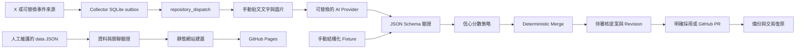

# Meridian-Schedule — VTuber 行程聚合器

依據 [VTuber_Schedule_SPEC.md](VTuber_Schedule_SPEC.md) 建立的 MVP，已實作 Phase 2 手動 AI Parser，以及 Phase 3～6 可在本機驗證的自動化、Collector、補漏、重試、備份與健康檢查。真實 X／AI 存取、GitHub 雲端 workflow 與 Raspberry Pi 運行仍須完成實測；不代表已通過全部 MVP 驗收。

正式 `data/` 已採用 [璃 Miri 的 2026/10/12–10/18 週表](https://x.com/Miri_Aetris/status/2109291418233827667)，由人工依貼文圖片整理，包含 6 場直播與 2 個休息日，保留來源貼文與 8 筆 Revision。這份資料未經 AI API 解析；週三、週六的「目前璃線中！」以休息呈現，未標示的平台與個別直播網址保留 `null`，行程異動仍以官方最新公告為準。

首頁預設使用台灣當日日期，切換「本週」可查看整週；若日期已不在週表範圍，請選擇 2026/10/16。原本的虛構範例資料保留於 `tests/fixtures/data/`，供測試與離線 fixture 命令使用。

## 架構與範圍



合併核心只處理資料，沒有檔案寫入或 repository 權限。`process_post` 將候選資料寫入單一提案檔，**不修改 `data/`**；另外使用 `apply_proposal --approve` 明確採用，或由 `publish_proposal` 在隔離 checkout 建立資料 PR。預設所有行程變更一律審核，高信心自動採用須明確設定 `REVIEW_ALL=false`。既有 Miri 週表仍是人工整理，沒有因這次實作而改動。

| 位置 | 用途 |
| --- | --- |
| `schemas/*.schema.json` | 成員、行程、變更提案、貼文與歷史的 JSON Schema |
| `processor/models.py` | Member／Event dataclass |
| `processor/schemas.py`、`validate.py` | Schema 驗證與跨檔資料關聯檢查 |
| `processor/merge.py` | 新增、修改、取消、忽略；保留完整前後快照 |
| `processor/classify.py` | 可設定的信心門檻與全數審核模式 |
| `processor/extract.py` | AI Provider Protocol 與可替換的 factory |
| `processor/manual.py` | 手動輸入與本機圖片處理 |
| `processor/openai_provider.py` | 第一個 Provider：OpenAI Responses API |
| `collector/` | PostSource Protocol、X API／JSONL 來源、SQLite outbox、dispatch、補漏與重試 |
| `processor/storage.py` | 檔案鎖、過期提案檢查所需指紋、備份與交易中斷復原 |
| `processor/media.py` | X 圖片下載、來源限制、大小與格式檢查 |
| `scripts/apply_proposal.py` | 重新 merge、驗證、備份後採用提案 |
| `scripts/process_event.py`、`publish_proposal.py` | 外部事件處理、重試、PR／提交與推送衝突處理 |
| `scripts/backup_data.py`、`health_check.py` | 備份、還原、資料與 Collector 狀態檢查 |
| `scripts/` | 驗證、手動提案與靜態建置命令 |
| `data/` | 正式成員、行程、來源與歷史，目前為人工整理的 Miri 週表 |
| `site/` | 原生 HTML／CSS／JavaScript，今日、本週及單一成員篩選 |
| `tests/` | Python／JavaScript 測試與六種貼文解析結果 fixtures |
| `tests/fixtures/data/` | 獨立的虛構測試基準，不隨正式週表更新 |
| `examples/manual-post.json` | 不含解析答案的手動文字輸入範例 |
| `.github/workflows/` | CI、貼文處理、每日補漏、備份與 Pages 部署 |
| `docs/operations.md`、`examples/collector*` | 上線設定、失敗復原與 Pi systemd 範本 |

沒有新增正式環境套件；Python 使用標準函式庫，前端使用原生 JavaScript。完整設定與目前限制請見 [操作手冊](docs/operations.md)。

## 本機執行

需求：Python **3.11+**；執行前端測試另需 Node.js **22+**。不需要 `pip install`、`npm install` 或前端 framework。所有命令在專案根目錄執行：

```sh
python -m scripts.validate_data
python -m scripts.build_site
python -m http.server 8000 --bind 127.0.0.1 --directory dist
```

開啟 <http://localhost:8000>。請透過 HTTP 開啟，直接雙擊 HTML 的 `file://` 模式無法正常載入 JSON。

若 Windows 的 `python` 指令連到未安裝的 Microsoft Store 執行別名，請將上述 `python` 換成實際 Python 執行檔路徑；PowerShell 的寫法為 `& '完整路徑\python.exe' -m scripts.build_site`。

## 手動測試變更流程

```sh
python -m scripts.process_post tests/fixtures/schedule-change.json --data-dir tests/fixtures/data
```

預設輸出 `.local/proposal.json`，包含 `decision`、原因、原始結構化 proposal、完整候選 schedule、posts 與 revisions。這個範例使用獨立的虛構測試基準，把 2026/10/16 的 20:00 改成 21:00，並保留修改前後快照及來源貼文。

可改用 `weekly.json`、`cancellation.json`、`sudden-stream.json`、`irrelevant.json`、`uncertain.json`。Fixtures 模擬 AI 已解析的 JSON；不驗證文字理解或圖片辨識能力。

預設策略：

- `confidence < 0.70`：`record_only`，候選行程保持原樣，貼文標為 `manual_review`。
- `confidence >= 0.70`：`review`，輸出候選變更，貼文標為 `pending_review`。
- 無關／未知分類只允許 `ignore`，不變更行程。

`ConfidencePolicy` 可透過 Python 設定 `auto_threshold`、`review_threshold`、`review_all`。`process_post` 預設全數審核，可用 `--auto --auto-threshold 0.95 --review-threshold 0.70` 回傳自動採用決策，但仍只寫提案。真正的採用端會重新計算策略，不信任提案內的 `decision` 或候選快照。

合併規則：

- `insert` 的同成員、日期、時間、標題、平台完全相同時視為重複；不同直播可同日存在。
- `update`／`cancel` 必須指定來源成員，並指定 event id 或日期；可加標題、平台、時間協助比對。模糊標題比對至少 0.6，時間距離最多 180 分鐘；候選分數差小於 0.15 時拒絕合併，需人工指定 id。
- `cancel` 只改狀態，不刪除事件。一般更新自動標記 `changed`，明確指定狀態時依提案處理。
- 更新不允許修改 event id、來源、信心分數等內部欄位，也不允許跨成員更新。
- 每批變更先在深層副本套用、驗證，再回傳結果；任何一筆失敗均不修改傳入資料。
- `posts` 中已出現的貼文，CLI 會拒絕重處理；事件 Processor 在呼叫 AI 前略過已記錄貼文。Collector 另有 SQLite 持久化去重與失敗重試。

採用前請先檢查 `.local/proposal.json`，再執行：

```sh
python -m scripts.apply_proposal .local/proposal.json --approve --data-dir tests/fixtures/data
```

這會實際修改指定的資料目錄；上例採用測試資料。正式採用時省略 `--data-dir`。採用前會比對基準資料指紋，過期提案必須重新產生；通過後才寫備份與交易日誌。不要將測試提案採用至正式資料。

## Phase 2：手動 AI Parser

第一個 Provider 使用 OpenAI Responses API，透過 Python 標準函式庫呼叫，不需要安裝 SDK。先在執行環境設定 `OPENAI_API_KEY`，並以 `OPENAI_MODEL` 或 `--model` 指定帳號可使用且支援圖片輸入與 JSON mode 的模型。程式不預設模型，也不會自動讀取 `.env`。

```sh
python -m scripts.process_post --manual examples/manual-post.json --data-dir tests/fixtures/data --model YOUR_VISION_MODEL
```

`YOUR_VISION_MODEL` 必須替換為實際模型名稱；若已設定 `OPENAI_MODEL`，可省略 `--model`。範例輸入使用 `demo-miri`，因此指定 `--data-dir tests/fixtures/data`；解析真實成員時改用正式成員 id 並省略該選項。上節的結構化 fixture 命令仍可離線執行，不需要 API Key。兩種輸入模式不可同時使用。

手動輸入只接受 `post`、`post_text`、`images`。例如將以下內容儲存為 `.local/weekly-post.json`，並把實際週表圖片放在 `.local/weekly.png`：

```json
{
  "post": {
    "source": "x",
    "post_id": "manual-weekly-001",
    "member_id": "demo-miri",
    "published_at": "2026-10-18T18:00:00+08:00",
    "source_url": "https://example.com/manual/weekly-001",
    "media": []
  },
  "post_text": "下週 10/19～10/25 的行程，請看圖片。",
  "images": ["weekly.png"]
}
```

```sh
python -m scripts.process_post --manual .local/weekly-post.json --data-dir tests/fixtures/data --output .local/weekly-proposal.json --timeout 60
```

圖片路徑以**輸入 JSON 所在目錄**為基準，也接受絕對路徑；本機圖片依檔頭辨識 PNG、JPEG、WebP，每張最多 10 MiB、合計最多 20 MiB。本機圖片轉成 Base64 data URL 傳給 Provider，提案不保存圖片內容或本機路徑。`post_text` 可省略或留空，但至少要有文字或圖片。

`images` 也可填 HTTPS 圖片網址；`post.media` 中的圖片網址會一併解析，相同網址只送出一次。圖片網址必須使用 HTTPS 且不含帳密，新增的網址會保存在候選 `posts.media`。本機端不下載遠端圖片，由 Provider 取得；無法存取的網址會導致解析失敗。每次最多接受 8 張圖片，遠端圖片仍受 Provider 的格式與大小限制。

`post` 必須提供上述六個欄位。`source: x` 代表原貼文來源，手動輸入並不會連線取得 X 貼文；`source_url`、發布時間與成員由使用者提供。範例皆為虛構資料，實際使用時請替換為真實來源。相對日期以貼文發布時間換算的台灣日期為基準；只提供該成員的現有行程協助比對，不以執行當天日期推算。

AI 在單次請求中完成分類及擷取。OpenAI Provider 使用 JSON mode 並附上既有 `changes.schema.json`；JSON mode 本身不保證符合 Schema，所有回應仍經本機 Schema、merge 與跨檔關聯驗證。流程沿用既有信心策略：低於 0.70 僅保留待人工確認結果，其餘行程變更一律產生待審核提案，不直接套用到 `data/`。

API 逾時、HTTP 錯誤、拒答、不完整回應、非法 JSON／Schema、圖片讀取失敗或事件比對失敗，命令會回傳非零結束碼。失敗不覆蓋已有提案，也不修改正式資料；API 錯誤本文、API Key 與圖片內容不寫入日誌。預設逾時 60 秒，可用 `--timeout` 調整。本階段不自動重試、不記錄持久化的 failed post；修正問題後可手動重跑。

Provider 可透過 Python 注入 `ScheduleInterpreter` 到 `process_manual_post`，或由 CLI 載入自己的 factory：

```sh
python -m scripts.process_post --manual .local/weekly-post.json --data-dir tests/fixtures/data --provider my_provider:create --model my-model
```

`my_provider` 必須在 Python 匯入路徑上；`create(*, model, timeout)` 回傳實作 `classify(post)` 與 `extract(post, current_schedule)` 的物件。`extract` 回傳符合 `changes.schema.json` 的 dict，包含 `classification`、`confidence`、`changes`、`reason`；主流程只呼叫 `extract` 一次。`post` 包含 `member`、`post_text`、`published_at` 與 `images`（HTTPS URL／data URL），`current_schedule` 包含 `updated_at` 與該成員的 `events`。自訂 Provider 自行讀取其服務的環境變數，不需要 OpenAI 憑證；服務失敗時應拋出 `InterpreterError`，且不在錯誤訊息附帶機密。Provider 選項只載入使用者指定的本機程式碼，不接受 AI 回應指定模組。

API 格式依 [OpenAI 圖片輸入文件](https://developers.openai.com/api/docs/guides/images-vision) 與 [JSON mode 文件](https://developers.openai.com/api/docs/guides/structured-outputs) 實作。離線測試驗證請求格式、模擬回應及提案流程；實際文字理解、週表辨識品質與帳號模型可用性，仍需設定 API 後使用真實貼文／圖片驗證。

## 資料約定

- MVP 僅支援 `Asia/Taipei`；`date` 為 `YYYY-MM-DD`，`time` 為 `HH:MM` 或 `null`。
- `scheduled`、`changed`、`live`、`finished` 必須有時間；時間尚未確定請使用 `tbd`。休息日可用 `day_off` 與 `time: null`。
- `updated_at`、貼文與歷史時間必須含時區；空行程可用 `updated_at: null`。
- `youtube` 成員欄位為頻道 URL；`twitch`、`x_username` 為帳號名稱或 `null`。
- 所有行程與 revision 均須有對應的 `posts` 來源，且來源屬於同一成員。Revision 儲存完整 Event 快照，新增事件的 `before` 為 `null`。
- `tests/fixtures/data/revisions.json` 為空陣列，代表測試初始基準；正式 `data/revisions.json` 已包含 Miri 週表新增事件的完整快照。
- JSON Schema 使用 Draft 2020-12 格式；Python 驗證器只實作這些 schema 使用的 `type`、`required`、`properties`、`additionalProperties`、`items`、`enum`、`const`、`minLength`、`minItems`、`pattern`、`minimum`／`maximum`、本地 `$ref` 與日期／時間／HTTP URL 格式檢查，並非通用 JSON Schema 引擎。新增關鍵字時必須同步擴充驗證器與測試。

新增成員時編輯 `data/members.json`；人工新增行程時也必須記錄對應的 `data/posts.json`。完成後先執行資料驗證，再重新建置 `dist/`；本機網頁重新整理後才會載入新資料。正式資料已移除虛構範例，請勿將測試基準複製回正式資料。

## 驗證

```sh
python -m unittest discover -s tests -v
node --check site/app.js
node --test tests/test_site.cjs
python -m scripts.validate_data
python -m scripts.build_site
```

Python 測試涵蓋六種 spec 情境、比對歧義、跨成員保護、整批失敗回滾、重複操作、非法資料與來源關聯，以及手動文字／圖片、可替換 Provider、API 請求與錯誤回應、失敗保留原有提案。另涵蓋 SQLite 並行去重、重試間隔、補漏 checkpoint、事件作者驗證、檔案鎖、部分寫入回復、過期提案、PR 與推送衝突。外部服務均以 mock 驗證，不呼叫真實 API，也不實際 commit／push。JavaScript 測試涵蓋台灣日期、跨年週範圍、排序、成員篩選、空資料與不安全連結。

手動 UI 驗證：以 375px 手機寬度確認無橫向捲動；切換今日／本週及成員；查看休息、待定、取消、突發狀態；停止伺服器後重新整理確認載入錯誤訊息。瀏覽器整合與真實 API 行為不包含於單元測試。

## GitHub Pages 部署

目前提供 CI 與 Pages workflow。前次雲端執行建置成功，但 Pages 部署回報 404，要求先啟用 Pages；本次新增 Pages 設定檢查，尚未觸發新的雲端部署。`Process X post` 完成後也會觸發 Pages workflow，處理由內建 `GITHUB_TOKEN` 提交資料而不觸發 push workflow 的情況。

1. 確認 GitHub repository 已包含專案檔案；部署流程假設正式分支名稱為 `main`，若不同請同步修改 `deploy-pages.yml` 的分支與 deploy 條件。
2. 在 repository 的 **Settings → Pages → Build and deployment → Source** 選擇 **GitHub Actions**。
3. 推送網站相關檔案至 `main`，或於 Actions 手動執行 **Deploy GitHub Pages**。
4. Workflow 先執行測試與資料驗證，建置 `dist/` 後部署。部署網址可在 `github-pages` environment 查看。

網站使用相對路徑，因此支援 `https://帳號.github.io/儲存庫名稱/`。公開產物只包含網站資源與 `members.json`／`schedule.json`；posts、revisions 與開發檔案不會由建置程式複製。公開 repository 內的原始檔仍可被讀取，請勿將機密寫入任何資料檔。

## 尚待上線驗證

1. 在 GitHub 啟用 Pages、設定 Secrets／Variables 及 Actions 建立 PR 的權限。
2. 確認 X 帳號具有單篇貼文、近期貼文與 Filtered Stream 的實際存取權；adapter 可替換，不保證帳號權限與費用。
3. 使用真實貼文與週表圖片驗證 AI 分類與辨識品質，再手動 dispatch 確認 PR 和 Pages 的完整流程。
4. 在 Pi 安裝 systemd 範本，確認重啟、斷線、心跳、補漏及日誌。
5. 維持 `REVIEW_ALL=true`，待解析結果穩定後才考慮啟用高信心自動採用。

真實 AI 解析需要 Provider 的 API Key；fixture、資料驗證、網站建置與測試不需要。YouTube／Twitch 的獨立資料來源 adapter、外部告警服務及跨機備援尚未加入。
