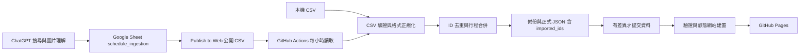

# Meridian-Schedule — VTuber 行程聚合器

現行完整規格見 [Technical Spec（v2.3 整合版）](VTuber_Schedule_SPEC_current.md)，以第一版為基礎整合後續修訂與目前實作；[v1](VTuber_Schedule_SPEC.md)、[v2](VTuber_Schedule_SPEC_v2.md)、[v2.1](VTuber_Schedule_SPEC_v2_1.md)、[v2.2](VTuber_Schedule_SPEC_v2_2.md)、[v2.3](VTuber_Schedule_SPEC_v2_3.md) 保留供版本追溯。

檔案用途與完整目錄樹見 [專案檔案結構](docs/project-structure.md)。

目前主流程：ChatGPT 將行程寫入 Google Sheet `schedule_ingestion`，GitHub Actions 每小時透過 Publish to Web 公開 CSV 讀取、驗證、去重及合併，有實際資料差異才提交並更新 Pages。GitHub 端不使用 Google Sheets API、Service Account、OAuth、X API 或 OpenAI API，也不回寫 Sheet；未新增正式環境相依套件。

v2.3 設定與離線範例見 [公開 CSV 匯入操作手冊](docs/ingestion.md)。Actions 只需 Repository Variable `SCHEDULE_CSV_URL` 與內建 `GITHUB_TOKEN`；CSV 匯入直接採用有效資料，不使用提案／審核流程。OAuth 雙表 Queue、X／AI API 自動管線及 Pi／RSS 補漏已退役，相關 workflows、CLI 與 systemd 範本已移除。手動 Parser、OpenAI Provider、提案採用與 PR 發佈也已退役，現在只維護 CSV 主流程、資料驗證、來源／歷史、備份復原與靜態網站。

正式 `data/` 已採用 [璃 Miri 的 2026/10/12–10/18 週表](https://x.com/Miri_Aetris/status/2109291418233827667)，由人工依貼文圖片整理，包含 6 場直播與 2 個休息日，保留來源貼文與 8 筆 Revision。這份資料未經 AI API 解析；週三、週六的「目前璃線中！」以休息呈現，未標示的平台與個別直播網址保留 `null`，行程異動仍以官方最新公告為準。

首頁預設使用台灣當日日期，切換「本週」可查看整週；若日期已不在週表範圍，請選擇 2026/10/16。原本的虛構範例資料保留於 `tests/fixtures/data/`，供測試與離線 CSV 範例使用。

## 架構與範圍



CSV 匯入直接更新指定資料目錄，使用檔案鎖、備份與交易復原，同步保存 `imported_ids.json`。單列錯誤略過並警告，CSV 下載或結構錯誤則保留既有資料；相同輸入重跑不更新時間戳。CSV `id` 就是正式事件 ID，相同 ID 可修正日期、時間、事件狀態、標題、平台與來源，保留初次建立時間並留下 Revision；更換成員會拒絕。v2.3 的 E 欄 `time` 只填時間或空白，F 欄 `event_status` 明確區分 scheduled/tbd/day_off/unknown/cancelled/postponed，對應既有 JSON `status`；舊 CSV 仍可使用。新 ID 僅作新增或重複防護，不依成員、日期、時間覆寫舊事件。取消、延期與恢復使用同 ID 的明確狀態，刪除與整張週表替換仍未提供。

行程補入或修正一律使用相同 CSV 格式；本機不解析貼文／圖片，也不接受舊提案 JSON。來源、Revision、receipt 及舊 CSV 相容規則繼續保留。

| 位置 | 用途 |
| --- | --- |
| `ingestion/schedule_csv.py`、`scripts/import_schedule.py` | v2.3 公開 CSV 下載、時間／狀態正規化與依 ID 更新 |
| `schemas/schedule_ingestion.schema.json`、`imported_ids.schema.json` | 正規化 CSV 列與儲存庫匯入 ID 格式 |
| `examples/schedule-ingestion.csv` | 單一工作表的十欄離線範例，含明確 event_status |
| `docs/ingestion.md`、`docs/chatgpt-task.md` | v2.3 公開 CSV 設定、先部署後遷移步驟與 ChatGPT 寫入提示 |
| `schemas/*.schema.json` | 成員、行程、貼文、歷史與 CSV 匯入的 JSON Schema |
| `processor/models.py` | Member／Event dataclass |
| `processor/schemas.py`、`validate.py` | Schema 驗證與跨檔資料關聯檢查 |
| `processor/storage.py` | 檔案鎖、備份校驗、交易寫入與中斷復原 |
| `scripts/backup_data.py`、`health_check.py` | 備份、還原、交易復原與正式資料健康檢查 |
| `scripts/` | CSV 匯入、驗證、備份復原與靜態建置命令 |
| `data/` | 正式成員、行程、來源、歷史與匯入 ID，目前為人工整理的 Miri 週表 |
| `site/` | 原生 HTML／CSS／JavaScript，今日、本週、單一成員及事件狀態複選篩選 |
| `tests/` | CSV、資料保護、維運與前端測試 |
| `tests/fixtures/data/` | 獨立的虛構測試基準，不隨正式週表更新 |
| `.github/workflows/` | CI、CSV 匯入、備份與 Pages 部署 |
| `docs/operations.md` | 現行維運、備份、還原與故障復原說明 |

沒有新增正式環境套件；Python 使用標準函式庫，前端使用原生 JavaScript。完整設定與目前限制請見 [操作手冊](docs/operations.md)。

## 本機執行

需求：Python **3.11+**；執行前端測試另需 Node.js **22+**。不需要 `pip install`、`npm install` 或前端 framework。所有命令在專案根目錄執行：

```sh
python -m scripts.validate_data
python -m scripts.build_site
python -m http.server 8000 --bind 127.0.0.1 --directory dist
```

開啟 <http://localhost:8000>。請透過 HTTP 開啟，直接雙擊 HTML 的 `file://` 模式無法正常載入 JSON。

頁首「深色模式」撥動開關可切換深／淺色。初次使用跟隨系統色系，手動切換後將偏好儲存在此瀏覽器，下次開啟時沿用；若瀏覽器封鎖儲存，仍可在本次瀏覽切換。

篩選區的「事件狀態」可複選正常、已異動、已取消、延期、直播中、已結束、休息、未知與待定，預設全部勾選。取消勾選會即時隱藏該狀態，並與日期、今日／本週及成員條件一起套用；全不勾選時不顯示行程，並提示勾選狀態。切換其他條件會保留目前勾選，重新載入網頁則恢復全部勾選。

若 Windows 的 `python` 指令連到未安裝的 Microsoft Store 執行別名，請將上述 `python` 換成實際 Python 執行檔路徑；PowerShell 的寫法為 `& '完整路徑\python.exe' -m scripts.build_site`。

## 本機 CSV 補入與修正

使用 [匯入手冊](docs/ingestion.md) 的隔離副本範例測試；正式匯入可指定 `--input 檔案.csv`，或設定 `SCHEDULE_CSV_URL`。同一事件修正沿用相同 ID，不重編或刪除既有事件。

```sh
python -m scripts.import_schedule --input YOUR_SCHEDULE.csv
python -m scripts.validate_data
python -m scripts.health_check
python -m scripts.build_site
```

請先將 `YOUR_SCHEDULE.csv` 換成已確認的 CSV；未指定 `--data-dir` 會直接更新正式 `data/`。CLI 不自行 commit／push；沒有變更不新增 Revision、備份或時間戳。備份與復原命令見 [操作手冊](docs/operations.md)。

## 資料約定

- MVP 僅支援 `Asia/Taipei`；`date` 為 `YYYY-MM-DD`，`time` 為 `HH:MM` 或 `null`。
- `scheduled`、`changed`、`live`、`finished` 必須有時間；時間尚未確定請使用 `tbd`。休息日可用 `day_off` 與 `time: null`。
- 外部擷取端無法判定時間或行程狀態時，新 CSV 填 `event_status=unknown` 並留空 `time`；只有沒有 `event_status` 標題的舊 CSV 才在 `time` 填 `unknown`／「未知」。匯入為 `status: unknown` 與 `time: null`，網頁時間欄及徽章皆顯示「未知」。官方明確標示時間未定仍使用 `tbd`。已移除工作日狀態，舊 CSV 的 `working_day` 請改為 `unknown`。
- `updated_at`、貼文與歷史時間必須含時區；空行程可用 `updated_at: null`。
- `youtube`、`twitch` 成員欄位為完整頻道 URL 或 `null`；`x_username` 為帳號名稱或 `null`。
- 成員必須提供 `group`（團體識別碼）與 `group_name`（團體顯示名稱）。目前使用 `neon`／`霓 NEO(n)`、`ianvs`／`扉暮 IANVS`、`teraz`／`序境 TeRaź`、`aetris`／`沉珀 Aetris`；沒有團體時 `group` 填 `none`，`group_name` 直接填成員的 `name`；合作藝人填 `collaborators`／`合作藝人`。
- 成員依 `data/members.json` 的陣列順序排列，合作藝人放在最後。KSP 保留成員資料與頻道連結，因不發布週表，預設為 `enabled: false`。
- 所有行程與 revision 均須有對應的 `posts` 來源，且來源 ID 唯一並屬於同一成員。來源可為 `x`、`discord`、`other`。Revision 儲存完整 Event 快照，新增事件的 `before` 為 `null`。
- `data/imported_ids.json` 保存已見過的 CSV row／event ID receipt，已匯入 ID 仍可更新；Sheet 的 status 不作正式 receipt。CSV 欄位、更新限制與舊 ID 相容方式見匯入操作手冊。
- `tests/fixtures/data/revisions.json` 為空陣列，代表測試初始基準；正式 `data/revisions.json` 已包含 Miri 週表新增事件的完整快照。
- JSON Schema 使用 Draft 2020-12 格式；Python 驗證器只實作這些 schema 使用的 `type`、`required`、`properties`、`additionalProperties`、`items`、`enum`、`const`、`minLength`、`minItems`、`pattern`、`minimum`／`maximum`、本地 `$ref` 與日期／時間／HTTP URL 格式檢查，並非通用 JSON Schema 引擎。新增關鍵字時必須同步擴充驗證器與測試。

新增成員時編輯 `data/members.json`；人工新增行程時也必須記錄對應的 `data/posts.json`。完成後先執行資料驗證，再重新建置 `dist/`；本機網頁重新整理後才會載入新資料。正式資料已移除虛構範例，請勿將測試基準複製回正式資料。

## 驗證

```sh
python -m unittest discover -s tests -v
node --check site/app.js
node --check site/theme.js
node --test tests/test_site.cjs
python -m scripts.validate_data
python -m scripts.build_site
```

Python 測試涵蓋 v2.3 明確事件狀態、時間配對驗證、取消／延期／恢復、舊 CSV 相容與無變更遷移，也涵蓋欄位、正規化、跨年、無效列略過、穩定 ID、初次建立時間、來源快照、ownership、碰撞、重複防護、no-op 與交易回復；storage 測試直接驗證寫入閘門、完整 Revision、鎖、備份完整性、失敗位元組回復與還原。維運測試另在只含 CSV／資料核心模組的副本執行 CSV 匯入、驗證、歷史／receipt、no-op、健康檢查及備份復原。外部服務均以 mock 驗證，不呼叫真實 API，也不實際 commit／push。JavaScript 測試涵蓋台灣日期、跨年、排序、篩選、空資料、不安全連結，以及未知／待定／休息／取消／延期的獨立顯示。

色系測試涵蓋系統預設、手動切換與重新載入、系統色系變動及儲存遭封鎖。

手動 UI 驗證：以 375px 手機寬度確認無橫向捲動；切換今日／本週及成員；複選事件狀態、全部取消後再勾選，確認行程與筆數即時更新，並以 Tab、空白鍵操作核取方塊；查看休息、待定、取消、突發狀態；切換深／淺色後重新整理，並以 Tab、空白鍵操作開關；停止伺服器後重新整理確認載入錯誤訊息與色系開關仍可使用。瀏覽器整合與真實 API 行為不包含於單元測試。

## GitHub Pages 部署

目前提供 CI、每小時 CSV 匯入與 Pages workflow。`Process ingestion` 成功完成後也會觸發 Pages workflow，處理由內建 `GITHUB_TOKEN` 提交資料而不觸發 push workflow 的情況；若公開 JSON 沒有變化會略過部署。部署結果請以 GitHub Actions 與 Pages environment 顯示為準。

1. 確認 GitHub repository 已包含專案檔案；部署流程假設正式分支名稱為 `main`，若不同請同步修改 `deploy-pages.yml` 的分支與 deploy 條件。
2. 在 repository 的 **Settings → Pages → Build and deployment → Source** 選擇 **GitHub Actions**。
3. 推送網站相關檔案至 `main`，或於 Actions 手動執行 **Deploy GitHub Pages**。
4. Workflow 先執行測試與資料驗證，建置 `dist/` 後部署。部署網址可在 `github-pages` environment 查看。

網站使用相對路徑，因此支援 `https://帳號.github.io/儲存庫名稱/`。公開產物只包含網站資源與 `members.json`／`schedule.json`；建置時會在公開 schedule 加入目前行程的 `sources` 網址對照，讓 X、Discord 與其他來源都能正確連結。posts、revisions 與開發檔案不會整份複製至 Pages。公開 repository 內的原始檔仍可被讀取，請勿將機密寫入任何資料檔。

## 尚待上線驗證

1. 建立 `schedule_ingestion`，發布為公開 CSV；只存放公開行程資訊。
2. 用 `docs/chatgpt-task.md` 提示執行一次，確認可搜尋官方來源、理解圖片、使用穩定 ID 並寫入 Sheet，再安排每小時執行。
3. 設定 Repository Variable `SCHEDULE_CSV_URL`、確認內建 Token 的資料寫入權限並啟用 Pages，手動執行 `Process ingestion` 驗證 CSV → JSON → Pages。
4. 使用相同 CSV 再跑一次，確認沒有額外 commit；測試錯誤單列及 CSV 無法下載時保留原資料。

v2.3 主流程不需要 Pi、Google API 認證或提案／Review UI。YouTube／Twitch 的獨立來源、外部告警通知與跨機備援尚未加入。程式碼退役不會代為停用遠端既有服務或撤銷憑證，先前部署過 Pi／systemd 的環境須另行停用；舊設定名稱不再啟用任何自動管線。
