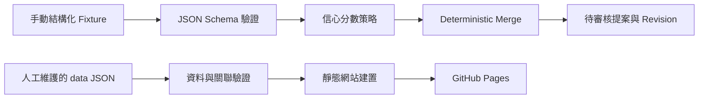

# Meridian-Schedule — VTuber 行程聚合器

依據 [VTuber_Schedule_SPEC.md](VTuber_Schedule_SPEC.md) 第 25 節建立的 MVP 骨架。這一版可在本機驗證 JSON、合併手動提供的結構化變更，並建置今日／本週靜態行程網站。

資料皆為虛構範例，日期固定為 **2026/10/16–10/18**，不是任何 VTuber 的實際公告。首頁預設使用台灣當日日期；若看不到範例，可在日期欄選擇 2026/10/16。

## 架構與範圍



合併核心只處理資料，沒有檔案寫入或 repository 權限。命令列將候選資料寫入單一提案檔，**不修改 `data/`**。審核、採用提案與建立 PR 留待後續階段實作。

| 位置 | 用途 |
| --- | --- |
| `schemas/*.schema.json` | 成員、行程、變更提案、貼文與歷史的 JSON Schema |
| `processor/models.py` | Member／Event dataclass |
| `processor/schemas.py`、`validate.py` | Schema 驗證與跨檔資料關聯檢查 |
| `processor/merge.py` | 新增、修改、取消、忽略；保留完整前後快照 |
| `processor/classify.py` | 可設定的信心門檻與全數審核模式 |
| `processor/extract.py` | 未來 AI Provider 的 Protocol，尚未串接服務 |
| `collector/x_source.py` | 未來貼文來源的 Protocol，尚未實作 Collector |
| `scripts/` | 驗證、手動提案與靜態建置命令 |
| `data/` | 虛構範例成員、行程、來源與歷史 |
| `site/` | 原生 HTML／CSS／JavaScript，今日、本週及單一成員篩選 |
| `tests/` | Python／JavaScript 測試與六種貼文解析結果 fixtures |
| `.github/workflows/` | CI 與 GitHub Pages 部署 |

沒有新增正式環境套件。X、AI、Pi、SQLite 去重、補漏排程、外部 dispatch、自動 commit／PR 尚未實作，也沒有佔位排程去呼叫不存在的服務。

## 本機執行

需求：Python **3.11+**；執行前端測試另需 Node.js **22+**。不需要 `pip install`、`npm install` 或前端 framework。所有命令在專案根目錄執行：

```sh
python -m scripts.validate_data
python -m scripts.build_site
python -m http.server 8000 --bind 127.0.0.1 --directory dist
```

開啟 <http://localhost:8000>。請透過 HTTP 開啟，直接雙擊 HTML 的 `file://` 模式無法正常載入 JSON。

若 Windows 的 `python` 指令連到未安裝的 Microsoft Store 執行別名，請將上述 `python` 換成實際 Python 執行檔路徑；PowerShell 的寫法為 `& '完整路徑\python.exe' -m scripts.build_site`。

## 手動測試變更流程

```sh
python -m scripts.process_post tests/fixtures/schedule-change.json
```

預設輸出 `.local/proposal.json`，包含 `decision`、原因、原始結構化 proposal、完整候選 schedule、posts 與 revisions。這個範例把 2026/10/16 的 20:00 改成 21:00，並保留修改前後快照及來源貼文。

可改用 `weekly.json`、`cancellation.json`、`sudden-stream.json`、`irrelevant.json`、`uncertain.json`。Fixtures 模擬 AI 已解析的 JSON；不驗證文字理解或圖片辨識能力。

預設策略：

- `confidence < 0.70`：`record_only`，候選行程保持原樣，貼文標為 `manual_review`。
- `confidence >= 0.70`：`review`，輸出候選變更，貼文標為 `pending_review`。
- 無關／未知分類只允許 `ignore`，不變更行程。

`ConfidencePolicy` 可透過 Python 設定 `auto_threshold`、`review_threshold`、`review_all`。即使關閉 `review_all`，`auto` 也只是核心回傳的決策，不會自行寫入資料。CLI 固定使用預設全數審核模式。

合併規則：

- `insert` 的同成員、日期、時間、標題、平台完全相同時視為重複；不同直播可同日存在。
- `update`／`cancel` 必須指定來源成員，並指定 event id 或日期；可加標題、平台、時間協助比對。模糊標題比對至少 0.6，時間距離最多 180 分鐘；候選分數差小於 0.15 時拒絕合併，需人工指定 id。
- `cancel` 只改狀態，不刪除事件。一般更新自動標記 `changed`，明確指定狀態時依提案處理。
- 更新不允許修改 event id、來源、信心分數等內部欄位，也不允許跨成員更新。
- 每批變更先在深層副本套用、驗證，再回傳結果；任何一筆失敗均不修改傳入資料。
- `posts` 中已出現的貼文，CLI 會拒絕重處理。這是檔案層的檢查，Pi 的持久化去重與重試尚未實作。

## 資料約定

- MVP 僅支援 `Asia/Taipei`；`date` 為 `YYYY-MM-DD`，`time` 為 `HH:MM` 或 `null`。
- `scheduled`、`changed`、`live`、`finished` 必須有時間；時間尚未確定請使用 `tbd`。休息日可用 `day_off` 與 `time: null`。
- `updated_at`、貼文與歷史時間必須含時區；空行程可用 `updated_at: null`。
- `youtube` 成員欄位為頻道 URL；`twitch`、`x_username` 為帳號名稱或 `null`。
- 所有行程與 revision 均須有對應的 `posts` 來源，且來源屬於同一成員。Revision 儲存完整 Event 快照，新增事件的 `before` 為 `null`。
- 範例 `revisions.json` 為空陣列，代表初始資料基準；透過 merge 產生的新增／修改／取消會建立 revision。
- JSON Schema 使用 Draft 2020-12 格式；Python 驗證器只實作這些 schema 使用的 `type`、`required`、`properties`、`additionalProperties`、`items`、`enum`、`const`、`minLength`、`minItems`、`pattern`、`minimum`／`maximum`、本地 `$ref` 與日期／時間／HTTP URL 格式檢查，並非通用 JSON Schema 引擎。新增關鍵字時必須同步擴充驗證器與測試。

新增成員時編輯 `data/members.json`；人工新增行程時也必須記錄對應的 `data/posts.json`。完成後先執行資料驗證。正式串接前請移除示範資料並設定真實成員。

## 驗證

```sh
python -m unittest discover -s tests -v
node --check site/app.js
node --test tests/test_site.cjs
python -m scripts.validate_data
python -m scripts.build_site
```

Python 測試涵蓋六種 spec 情境、比對歧義、跨成員保護、整批失敗回滾、重複操作、非法資料與來源關聯。JavaScript 測試涵蓋台灣日期、跨年週範圍、排序、成員篩選、空資料與不安全連結。

手動 UI 驗證：以 375px 手機寬度確認無橫向捲動；切換今日／本週及成員；查看休息、待定、取消、突發狀態；停止伺服器後重新整理確認載入錯誤訊息。瀏覽器整合與真實 API 行為不包含於單元測試。

## GitHub Pages 部署

專案已搬入 Meridian-Schedule Git 儲存庫；目前提供 CI 與 Pages workflow，尚未驗證 GitHub Pages 雲端部署。

1. 確認 GitHub repository 已包含專案檔案；部署流程假設正式分支名稱為 `main`，若不同請同步修改 `deploy-pages.yml` 的分支與 deploy 條件。
2. 在 repository 的 **Settings → Pages → Build and deployment → Source** 選擇 **GitHub Actions**。
3. 推送網站相關檔案至 `main`，或於 Actions 手動執行 **Deploy GitHub Pages**。
4. Workflow 先執行測試與資料驗證，建置 `dist/` 後部署。部署網址可在 `github-pages` environment 查看。

網站使用相對路徑，因此支援 `https://帳號.github.io/儲存庫名稱/`。公開產物只包含網站資源與 `members.json`／`schedule.json`；posts、revisions 與開發檔案不會由建置程式複製。公開 repository 內的原始檔仍可被讀取，請勿將機密寫入任何資料檔。

## 後續實作順序

1. 實作可替換的 AI Provider，以手動文字／圖片驗證分類與結構化輸出。
2. 加入審核提案的採用流程、`repository_dispatch` 與建立 PR 的 GitHub Actions。
3. 驗證 X 事件來源後才實作 Collector、SQLite 去重與 dispatch。
4. 在同一條處理流程加入每日補漏、重試與失敗復原。
5. 資料穩定後再啟用自動採用門檻、監控與備份。

API timeout、rate limit、媒體下載與 push conflict 處理屬於後續外部整合範圍；目前不需要任何 API Key。
